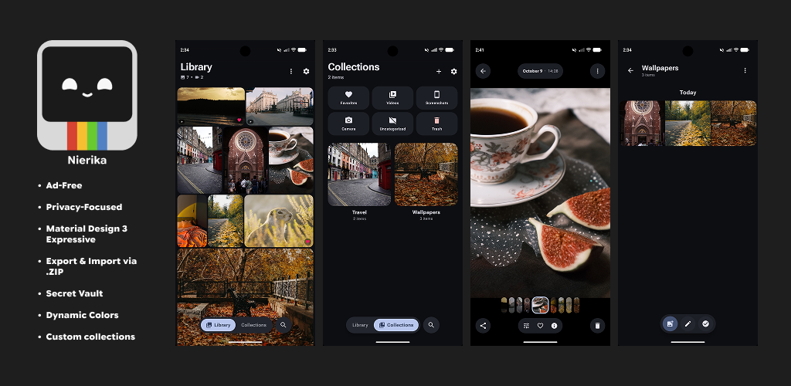
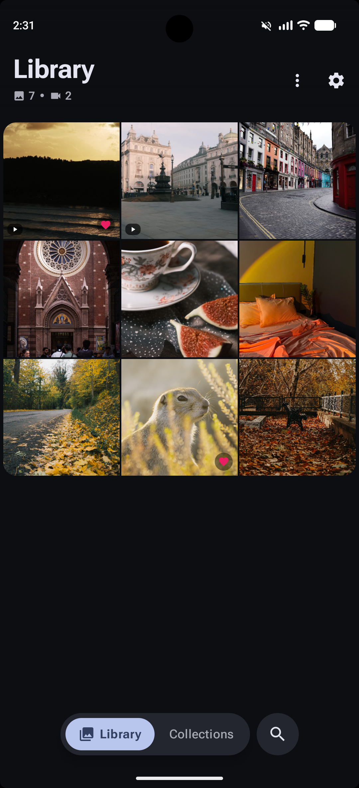
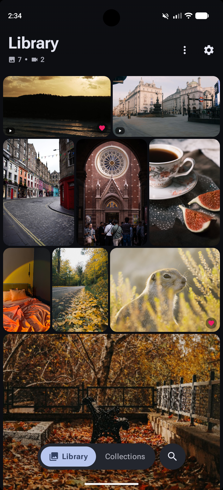
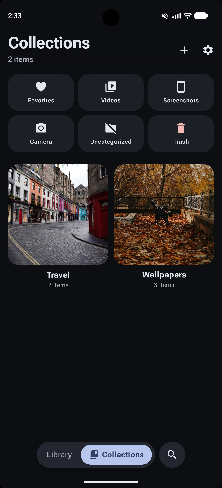
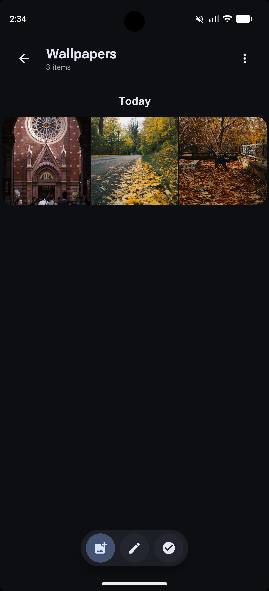
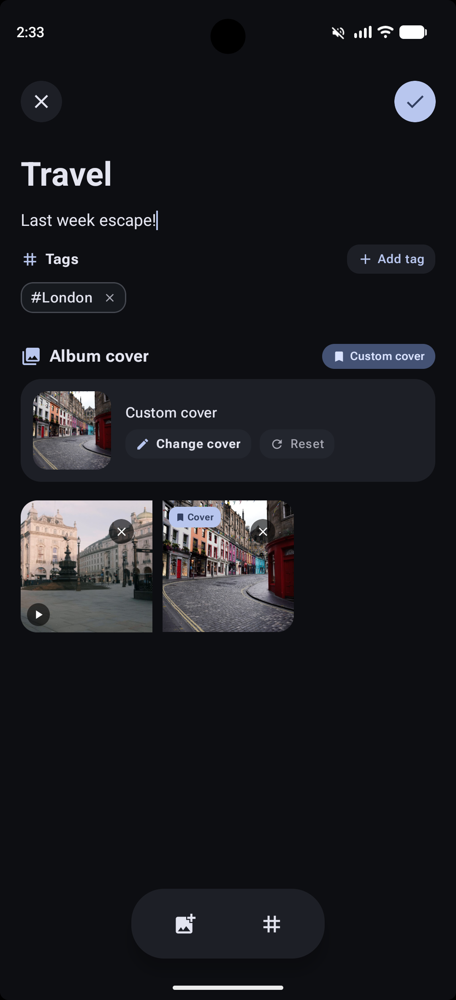
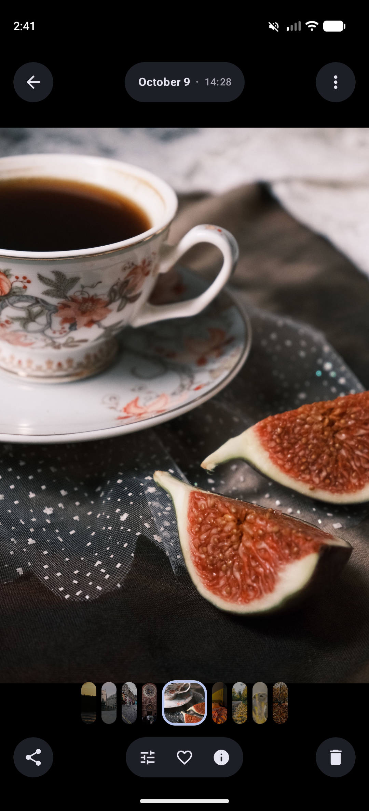
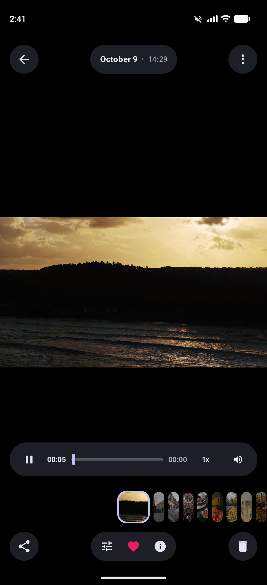
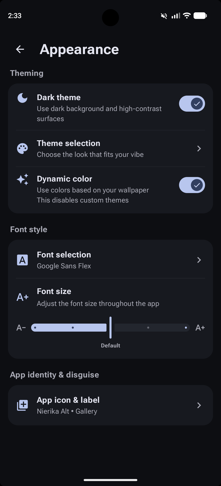

# Nierika - Modern Gallery & Vault

**Nierika** is a clean, modern, and privacy-focused gallery app for Android, built with Kotlin and Jetpack Compose. Crafted around Material Design 3 Expressive, it gives you smooth animations, adaptive support for foldables and large screens, deep visual personalization, built-in photo and video editing, and a protected secret vault—all while staying 100% offline with zero ads and zero tracking.

[](https://github.com/Ixeken-Studios/nierika-app/releases/latest)




## Key Features

### Material 3 Expressive Design & Theming
- **Foldables & large screens:** Fully adaptive UI designed for foldables, tablets, and wide displays, scaling seamlessly with dynamic multi-column grids and orientation changes.
- **Fluid animations:** Smooth spring motion and gesture transitions that feel lively and natural.
- **Dynamic colors:** Adapts automatically to your wallpaper, or lets you choose from 13 custom color palettes.
- **Custom typography:** Switch freely between 8 bundled fonts (Google Sans Flex, Outfit, DM Sans, Nunito, Josefin Sans, and more) or keep your system default font.
- **Customizable layout:** Pick between a modern floating pill navbar and a classic docked bottom bar, and adjust category button positions to your liking.

### Media Organization & Custom Albums
- **Versatile timeline:** View your photos by Day, Month, or in a clean "Comfy" grid, complete with an interactive date bubble for fast scrolling.
- **Custom albums:** Organize collections with personalized cover photos, custom descriptions, and tags.
- **Smart filters:** Quick shortcuts for Favorites, Videos, Screenshots, Camera shots, Uncategorized items, and Trash.
- **Export & import via .ZIP:** Easily back up or move entire albums using standard .zip files without relying on cloud services.
- **Batch management:** Multi-select items to organize, favorite, move to trash, or restore in seconds.

### Built-in Photo & Video Studio
- **Canvas expansion:** Enlarge your photo frame to square (1:1), portrait (4:5, 9:16), wide (16:9), or custom ratios using blurred background fills or solid colors.
- **Photo adjustments:** Simple sliders to fine-tune brightness, contrast, saturation, highlights, shadows, and warmth.
- **Markup & privacy blur:** Draw with custom brush sizes, write styled text, or use the pixelate tool to censor sensitive information.
- **Crop & rotate:** Freeform and preset crop ratios, 90° rotation, and horizontal or vertical flipping.
- **Video editing:** Trim playback, adjust volume levels, mute audio, or save any video frame as a photo, powered by AndroidX Media3.

### Secret Vault & Camouflage
- **Protected vault:** An isolated space locked with your PIN or biometric fingerprint/face unlock to keep private photos and videos away from gallery scans.
- **Stealth disguise:** Change the launcher icon and name at any time to disguise Nierika as **Nepo Calculator**, **Drafto Notes**, **Camera**, **Library**, or standard **Gallery**.
- **ZIP backup:** Export your secret vault into a standard ZIP archive whenever you need to save a local backup.

### EXIF Details & Metadata Cleaner
- **Photo info at a glance:** Inspect camera model, exposure settings, ISO, focal length, flash status, and GPS altitude.
- **One-tap privacy cleaner:** Strip all camera, device, and location tags from photos before sharing them online.

### 100% Offline & Absolute Privacy
- **No ads, no trackers:** Zero telemetry, zero analytics libraries, and zero cloud uploads. Your memories stay strictly on your phone.
- **Transparent updates:** An optional update checker that only contacts GitHub Releases when you explicitly ask it to.

## Screenshots

<p align="center">
  
  
  
  
</p>
<p align="center">
  
  
  
  
</p>

## Tech Stack

| Layer | Technology |
|---|---|
| Language | Kotlin 2.x |
| UI & Design | Jetpack Compose, Material Design 3 Expressive, Compose Navigation, Coil 3 |
| Architecture | Multi-Module Gradle, Clean Architecture, MVI (Model-View-Intent) |
| Dependency Injection | Dagger Hilt 2.60 |
| Media & Playback | AndroidX Media3 (ExoPlayer, Transformer, Effects), Coil (Images, GIFs, Videos) |
| Database & Persistence | Room 2.8, DataStore Preferences, Paging 3 |
| Image Processing | AndroidX ExifInterface, Vanniktech Image Cropper |
| Security & Biometrics | AndroidX Biometric |
| Build & Tooling | Kotlin DSL, Version Catalogs (`libs.versions.toml`), KSP, R8/Proguard optimization |

<p align="center">
  &nbsp;&nbsp;
  &nbsp;&nbsp;
  &nbsp;&nbsp;
  
</p>

## Requirements

To build and run Nierika locally, ensure you have:
- **Android Studio Koala** (2024.1.1) or newer.
- **JDK 17** or newer (Android Studio comes with an embedded JetBrains Runtime JBR which is fully compatible).
- **Android SDK Platform 37** (Minimum SDK 34) installed via Android Studio SDK Manager.

## Getting Started

### 1. Clone the repository
```bash
git clone https://github.com/Ixeken-Studios/nierika-app.git
cd nierika-app
```

### 2. Build the application

- **Debug Build (Recommended for testing):**
  - *Linux/macOS:* `./gradlew assembleDebug`
  - *Windows:* `.\gradlew.bat assembleDebug`

- **Release Build (Requires local signing configuration in `keystore.properties`):**
  - *Linux/macOS:* `./gradlew assembleRelease --no-configuration-cache`
  - *Windows:* `.\gradlew.bat assembleRelease --no-configuration-cache`

The compiled APKs will be located in: `app/build/outputs/apk/`

## Acknowledgements

- **[Material Design 3](https://m3.material.io/)** - For the modern, expressive design foundation and tonal palette system.
- **[Coil](https://coil-kt.github.io/coil/)** - For lightweight, asynchronous image and video thumbnail loading.
- **[AndroidX Media3](https://developer.android.com/media/media3)** - For media playback and video transformer editing engines.
- **[Android Image Cropper](https://github.com/CanHub/Android-Image-Cropper)** - For robust cropping and transformation utilities.

## License
<p align="center">
  
</p>

This project is licensed under the MIT License - see the [LICENSE](LICENSE) file for details.
